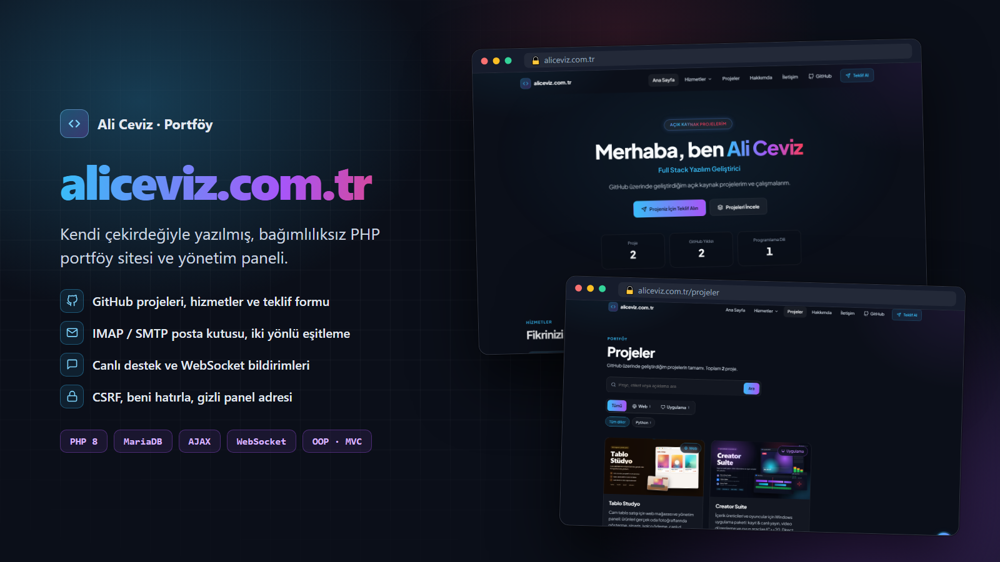

# aliceviz.com.tr — Portföy, Hizmetler ve Yönetim Paneli



**Canlı site:** [aliceviz.com.tr](https://aliceviz.com.tr)

GitHub projelerini yayınlayan, web sitesi / masaüstü uygulama hizmetleri sunan, nesne tabanlı (OOP) bir PHP sitesi ve yönetim paneli. Framework veya Composer bağımlılığı yoktur.

## Özellikler

**Site**
- GitHub projelerinin otomatik listelenmesi (arama, dil filtresi, AJAX sayfalama)
- Hizmetler (web sitesi / masaüstü uygulama), paketler ve teklif formu
- CV tarzı "Hakkımda" sayfası (yazdır / PDF)
- İletişim formu (telefon maskesi), sağ altta **canlı destek** sohbeti ve sohbet sonu değerlendirmesi
- Bakım modu, koyu tema, mobil uyumlu tasarım

**Yönetim paneli**
- Projeler, GitHub içe aktarma, özgeçmiş, teklif talepleri, hizmet ve teklif formu düzenleyicisi
- **Posta kutusu entegrasyonu (IMAP/SMTP):** cPanel, Gmail, Yandex vb. — tüm klasörlerin (Gelen, Gönderilen, Taslak, Spam, Çöp) iki yönlü senkronizasyonu, okunmamış/toplam sayaçları, toplu işlemler
- **Canlı destek** paneli (anlık yazışma, "yazıyor..." göstergesi, memnuniyet istatistikleri)
- WebSocket ile anlık bildirimler (paylaşımlı hostingde otomatik yoklamaya geçer), DataTables listeler, sürükle-bırak sıralama
- Projeleri Web / Uygulama olarak etiketleme, gizli panel adresi
- "Beni hatırla" (güvenli, kendini yenileyen çerez), kayıtlı cihaz yönetimi

## Teknik

- PHP 8.1+ · MySQL / MariaDB · Apache (mod_rewrite)
- Kendi küçük çekirdeği: Router, Middleware, Active Record model, tema parçalama sistemi
- Bağımlılıksız SMTP ve IMAP istemcileri (PHP imap eklentisi gerekmez)
- Saf PHP WebSocket sunucusu (`realtime/server.php`) ve AJAX katmanı (`assets/js/ajax.js`)
- Veritabanı güncellemeleri: `database/migrations/*.sql` (otomatik uygulanır)

## Kurulum

```bash
git clone https://github.com/alicvz38/aliceviz.com.tr.git
cd aliceviz.com.tr
copy config\config.example.php config\config.php     # Linux/macOS: cp config/config.example.php config/config.php
```

1. `config/config.php` içindeki veritabanı bilgilerini düzenleyin.
2. **Panel şablonu:** Panel, ücretli [Equation](https://themeforest.net/) Bootstrap 5 şablonunu kullanır ve lisansı gereği depoya dahil değildir. Satın aldığınız kopyayı proje köküne `equation-v2.2.0/` adıyla yerleştirin.
3. Tarayıcıda `http://localhost/install.php` adresini açıp kurulumu tamamlayın, ardından panele giriş yapın: `http://localhost/admin` (canlıda `config.php` içindeki `prefix` değerini tahmin edilemeyen bir adresle değiştirin)
4. (İsteğe bağlı) Anlık bildirimler için canlı sunucuyu başlatın: `realtime\baslat.bat` · Linux: `php realtime/server.php`

Ayrıntılı Türkçe kurulum ve kullanım rehberi: [KURULUM.md](KURULUM.md)

## Güvenlik notları

- `config/config.php`, `storage/realtime.key`, yüklenen görseller ve çalışma zamanı dosyaları `.gitignore` ile depo dışında tutulur.
- E-posta (SMTP/IMAP) şifreleri veritabanında saklanır, kodda yer almaz.
- Canlıya alırken `config.php` içinde `'debug' => false` yapın ve `install.php` dosyasını silin.

## Lisans

[MIT](LICENSE) — dilediğiniz gibi kullanabilirsiniz; adınızı ve lisans metnini korumanız yeterli. Equation panel şablonu bu lisansa dahil değildir.

---

Geliştirici: **Ali Ceviz** · [aliceviz.com.tr](https://aliceviz.com.tr) · [github.com/alicvz38](https://github.com/alicvz38)
